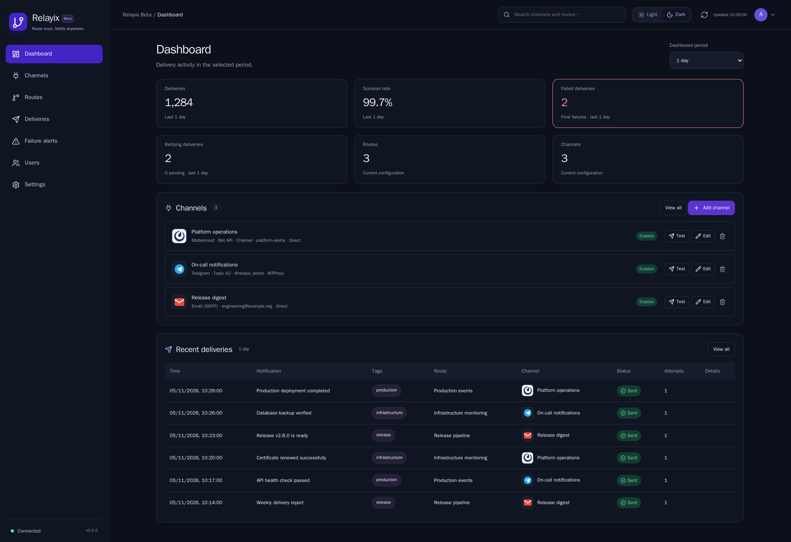
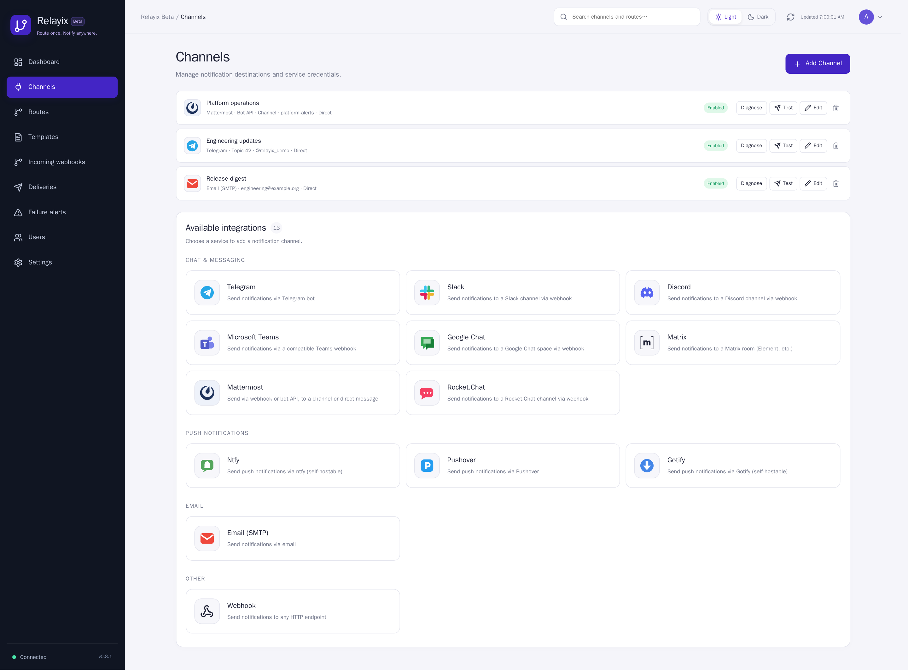

# Relayix 0.6.3 Beta

A self-hosted notification hub: Rust / Axum / React / PostgreSQL. English interface, light and dark themes.

## Docker Compose quick start

You need **Git and Docker with Compose v2.20+**. The repository root contains `compose.yaml` and `relayix.env.example`. Compose runs the published image with `relayix-app` and optional `relayix-db` on the shared `relayix-network`.

For a new installation:

```bash
git clone https://github.com/devops-nechaev/Relayix.git
cd Relayix
cp relayix.env.example .env
```

If the repository is already cloned, run `cp relayix.env.example .env` from its root. Keep an existing `.env` when updating an installation.

Open `.env` and set **`POSTGRES_PASSWORD`** and **`ADMIN_PASSWORD`** to your own passwords. Keep the single quotes around passwords. The administrator password needs 12–128 characters, uppercase/lowercase letters, a number and a symbol.

```bash
chmod 600 .env
docker compose up -d
```

Open **`http://SERVER_IP:8080`** and sign in as **`admin`** with the `ADMIN_PASSWORD` you chose. Replace `SERVER_IP` with the IP address of your Docker host. Compose downloads the published image and starts Relayix and PostgreSQL automatically. Database data is stored in a persistent Docker volume.

Choose the database in `.env`:

| Setting | Bundled PostgreSQL | External PostgreSQL |
| --- | --- | --- |
| `DATABASE_MODE` | `local` | `external` |
| `POSTGRES_HOST` | Leave empty | Server hostname or IP |
| `POSTGRES_PASSWORD` | Your new database password | Existing database password |
| `POSTGRES_SSLMODE` | Ignored | `verify-full` for TLS, `disable` for a server without TLS |
| `POSTGRES_CA_PATH` | Leave empty | Optional path to the CA certificate on the Docker host |

For an external server, also set `POSTGRES_PORT`, `POSTGRES_USER` and `POSTGRES_DB` to its existing values. The bundled PostgreSQL service is disabled in external mode. TLS and a private CA use the same Compose file and command. See the [setup guide](docs/DEPLOYMENT.md) for examples.

## Updating

Change the app image tag in your `compose.yaml`, then run:

```bash
docker compose pull app
docker compose up -d --no-deps app
```

Schema migrations run automatically. Keep your `.env`, Compose project name and database volume.

## Screenshots

The screenshots use demonstration data and show the current interface.

### Dashboard · dark theme



### Channels and integrations · light theme



## Runtime and dependencies

Application, build and test images use Debian 13 Trixie. The verified toolchain is Rust 1.99.1, Node.js 26.13.0 LTS and Python 3.15.2; PostgreSQL uses the maintained 17.11 release on Trixie. Debian packages are upgraded from stable repositories during application/test image builds. Cargo, npm and Python dependencies are locked, and Python packages retain mandatory artifact hashes.

The November 2026 refresh includes React 19.3.1, Vite 8.3.6, Lucide 1.69.0, SQLx 0.9.0, Reqwest 0.13.5, Argon2 0.6.0 and rand 0.10.3. Keep the existing database image and data volume when updating the app. `RELAYIX_DB_VOLUME` selects an existing named data volume; keep that setting in the private deployment JSON for installations managed by the deployment scripts.

## Accounts and profiles

- Username/password login with Argon2id password hashes and salted passwords.
- Passwords must contain 12–128 characters, uppercase/lowercase letters, a number and a symbol. Usernames and common sequences (`password`, `qwerty`, `123456`, `letmein`) are rejected in passwords. The UI shows requirements; the API enforces them too.
- Administrators create/edit/delete users, set roles, disable accounts and reset passwords. The last active administrator and your own administrator account are protected from removal/demotion.
- Members can manage shared channels, routes and deliveries. This is one shared notification hub, not isolated workspaces per user.
- The account button opens a menu with the real user's name, profile, settings and sign out. Profile supports display name and password changes.
- Password changes revoke other sessions. Administrative resets and disabling a user revoke all their sessions.
- Sessions expire after seven days. Session tokens are hashed in PostgreSQL. Browser cookies are HttpOnly and SameSite=Strict. Cookie-authenticated API requests require `X-Relay-Client: web`; no cross-origin API access is enabled.
- `COOKIE_SECURE=true` enables Secure cookies behind HTTPS. Leave false for direct HTTP access on the configured LAN IP.
- The optional administrator API token remains available for automation and token login. It is not an individual user's profile.
- Login attempts are limited to ten failures per username in fifteen minutes.

## Personal settings

In **My profile → Interface notifications**, set auto-close to 1–300 seconds (default 8), or 0 for manual dismissal. Success and error banners always have a close button, including inside dialogs. Timers pause on hover or keyboard focus. This setting belongs to the account and follows it across devices.

Settings belong to the authenticated account and are stored in PostgreSQL. Theme, automatic refresh interval, saved delivery filters (including tags), route tag filter, list search and delivery page size follow the user between browsers and devices. Another account has its own preferences. The administrator API-token identity has separate preferences.

Use **Settings → Notification monitoring** to set a custom refresh interval from 5 to 3600 seconds; `0` disables automatic refresh. Manual Refresh remains available. Choose 10, 25, 50 or 100 deliveries per page. Theme and applied filters save automatically; monitoring settings use **Save settings**. Saving errors are shown and can be retried. Pending changes are flushed before sign out.

## Dashboard and Refresh

Choose 5, 15 or 30 minutes, 1 hour, 1 day, 7 days or 30 days. The selected window applies to every delivery metric and recent delivery history, and follows failed/retrying links into Deliveries. The period is saved to your account. Routes and Channels show current configuration counts.

The dashboard displays final failed deliveries, deliveries being retried, pending deliveries, total deliveries and success rate for the selected period. Clicking failed/retrying counts opens the corresponding delivery filter.

Refresh makes uncached requests, shows progress, updates the last refresh time and reports success or errors. Successful resources can update even if another endpoint fails. Background refresh follows the saved account interval (15 seconds by default) while the page is visible.

## Channels and routing

All channels support an authenticated **HTTP proxy** with an IP/DNS host, port, login and password. HTTPS and SMTP use CONNECT; proxy failure never silently falls back to direct delivery. Telegram also offers **MTProto** and native **WEB-proxy** modes using application credentials configured once on the server (`TELEGRAM_API_ID` / `TELEGRAM_API_HASH` in `.env`). The proxy provider supplies only host, port and secret; MTProto authorization separately requires these application credentials. Bot chat access hashes are handled automatically. MTProto supports plain/dd and ee FakeTLS secrets with an SNI domain; WEB supports plain/dd. WEB base paths are explicitly rejected. See [proxy configuration and verification limits](docs/PROXIES.md).

Dashboard and delivery history show the destination service icon beside the channel name.

SMTP offers separate **Sender name** and **From address** fields. For example, `Relayix Alerts` and `alerts@example.org` produce `Relayix Alerts <alerts@example.org>`. Existing `Name <address>` configurations continue to work. A separate nonempty sender name takes precedence over the name embedded in From address. The SMTP account must be allowed to send from the configured address.

Route **Minimum priority** filters the notification's JSON `priority`, from 1 (lowest) to 5 (highest). A minimum of 4 accepts priorities 4 and 5. Omitted notification priority defaults to 3. This threshold filters delivery; it does not change queue ordering.

Routes is the single place to manage permanent webhook endpoints, recipients, tags and route keys. Each card displays its endpoint and recipient names, integration icons and delivery methods. Use **Copy**, **Integration guide**, **Edit** or **Rotate key** on the card. Keys are displayed once after creation or rotation and stored as hashes; replace `YOUR_ROUTE_KEY` in the integration example. Rotation invalidates the previous key. The former API Tokens page has been removed.

Mattermost supports both existing incoming webhooks and **Bot / REST API**. Enter the server URL and bot or personal access token, then choose a channel ID or a direct-message recipient (`@username` or user ID). Add the sender to the destination channel. Delivery uses the [official Mattermost v4 API](https://docs.mattermost.com/api/reference/create-post). Credentials remain masked when editing a channel.

13 integrations with local SVG icons: Telegram, Matrix, Mattermost, Rocket.Chat, Slack, Discord, Microsoft Teams (compatible webhook), Google Chat, ntfy, Pushover, Gotify, Email (SMTP) and Webhook.

Configure a channel, use Test, and assign it to a route. Enter a route name and select recipients; a unique permanent webhook address is generated automatically. Existing `/h/{slug}` addresses and hashed `X-Relay-Key` values are preserved. Renaming a route never changes its address. Routes shows the full, selectable endpoint without ellipsis; key-copy feedback is displayed inside the key dialog. Changing recipients does not require changing the sending integration.

### Telegram topics

Telegram channels support bot token, chat ID and optional **Topic ID**. The topic ID is sent as the numeric [`message_thread_id`](https://core.telegram.org/bots/api#sendmessage). Leave it empty for the chat's default destination. Example config:

```json
{"bot_token":"123:bot-token","chat_id":"-1001234567890","message_thread_id":"42"}
```

### Matrix and SMTP

Matrix requires a homeserver URL, bot access token and a room ID such as `!room:example.org`; invite the bot to the room. Room aliases and encrypted rooms are unsupported. Matrix deliveries retain their transaction ID across retries.

SMTP supports STARTTLS (usually port 587), implicit TLS (usually 465), optional paired username/password, sender and one recipient mailbox per channel. Add multiple channels for multiple mailboxes. Unencrypted SMTP requires explicitly setting `ALLOW_INSECURE_HTTP=true`, which also permits LAN HTTP webhook destinations.

Secret fields are masked in channel responses, and unchanged masked values are preserved when editing. Channel credentials remain stored in PostgreSQL; restrict volume and backup access.

### Tags

A route's **Required tag** limits delivery to incoming events that contain that exact tag. It is displayed as a tag badge and can be used to filter Routes. Event tags appear in the Deliveries table; click a tag or use the Tag filter to show matching deliveries. Tag matching is exact. Suggested tags include route requirements and historical event tags. Route requirements and actual event tags are separate: setting a route requirement does not add a tag to an incoming event.

### Send an event

```bash
curl --fail-with-body -X POST http://192.168.39.110:8080/h/gitlab-deploy \
  -H "X-Relay-Key: $RELAYIX_KEY" \
  -H 'Content-Type: application/json' \
  -d '{"title":"Deployment successful","message":"auth deployed to production","priority":3,"tags":["deploy"]}'
```

A successful response confirms queuing, not delivery. Check Deliveries for the result. The PostgreSQL worker uses row locking, stale-worker recovery and five attempts with exponential backoff; delivery is at least once.

## Failure alerts

Administrators configure **Failure alerts**:

- Choose watched channels and routes; empty selection means all. Both filters must match.
- Select the number of distinct failing deliveries, minimum attempts per delivery, rolling failure window and cooldown.
- Choose one or more destination channels and customize the warning title/message.
- Text fields: `{failures}`, `{channel}`, `{route}`, `{error}`, `{title}`. For multiple failures, channel/route/error/title describe the latest matching failure.
- Defaults warn after the first unsuccessful attempt, before all normal retries are exhausted.
- Each failing delivery triggers a rule once. Cooldown delays warnings about additional failures and prevents repeated bursts.
- Warnings have a persistent separate outbox with retries and delivery history. Their own failures never generate further failure alerts. Failed warnings can be retried manually.
- Test rule queues an explicit test warning for enabled recipients; inspect alert history for its outcome.

Use an independent working destination for warnings about another destination's failures.

## Deliveries

Filters run on the server before pagination: status, channel, route, tag, date range and title/channel/route/error text. Results include the notification title, attempts, expandable error details and manual retry for failed/retrying deliveries. Pages use the account page-size setting (50 by default), with a filtered total. API `page_size` accepts 1–100.

Templates are disabled in 0.4: no menu, route selection, rendering or template API. Historical template rows and old migration files are retained so existing database data is not destroyed.

## API

Use an authenticated browser session plus `X-Relay-Client: web`, or `Authorization: Bearer ADMIN_TOKEN`. `/h/{slug}` continues to use only its own `X-Relay-Key`.

| Method | Path | Purpose |
| --- | --- | --- |
| GET | `/healthz` | Health and release version |
| POST | `/api/auth/login` | Username/password login; returns HttpOnly session cookie |
| POST | `/api/auth/logout` | Revoke current session |
| GET | `/api/auth/me` | Current account and role |
| PUT | `/api/auth/profile` | Display name/password update |
| PUT | `/api/auth/preferences` | Validate and save account preferences |
| GET | `/api/tags` | Distinct suggested route/event tags |
| GET / POST | `/api/users` | List/create users; administrator only |
| PUT / DELETE | `/api/users/{id}` | Edit/delete user; administrator only |
| GET / POST | `/api/channels` | List/create channels |
| PUT / DELETE | `/api/channels/{id}` | Edit/delete channel |
| POST | `/api/channels/{id}/test` | Direct test notification |
| GET / POST | `/api/routes` | List/create routes |
| PUT / DELETE | `/api/routes/{id}` | Edit/delete route |
| POST | `/api/routes/{id}/rotate` | Rotate route key |
| GET | `/api/stats` | Delivery and failure counters |
| GET | `/api/deliveries` | `{items,total,page,page_size}` with filters |
| POST | `/api/deliveries/{id}/retry` | Retry failed/retrying delivery |
| GET / POST | `/api/alert-policies` | List/create failure rules; administrator only |
| PUT / DELETE | `/api/alert-policies/{id}` | Edit/delete failure rule |
| POST | `/api/alert-policies/{id}/test` | Queue test warning |
| GET | `/api/alert-deliveries` | Warning history |
| POST | `/api/alert-deliveries/{id}/retry` | Retry failed warning |

Delivery query fields: `status` (`sent`, `failed`, `queued`, `processing`, `retrying`), `channel_id`, `route_id`, `tag`, `from`, `to` (RFC 3339 timestamps), `search`, `period` (`5m`, `15m`, `30m`, `1h`, `24h`, `7d`, `30d`), `page`, `page_size`.

## Development and verification

```bash
scripts/check.sh
```

The verification script requires Docker Compose, Python 3 and OpenSSL on the host. Docker builds use the committed Cargo.lock and npm package-lock.json. The check script builds Rust/React, runs Rust unit tests, creates a temporary PostgreSQL database and local HTTP/SMTP providers, runs API/queue/SMTP checks and then Chromium desktop/mobile tests. It always removes its isolated containers. Screenshots and failure logs are written to `/tmp/relayix-test-artifacts`, outside the source tree. Tests do not send to real provider accounts.

For development without Docker, install Rust 1.99.1+ and Node 26.13+, run `npm ci` and `npm run build` in `web/`, then `cargo test --locked` from the root.

GitHub CI, GHCR delivery and first repository setup are described in [docs/GITHUB.md](docs/GITHUB.md). See [CONTRIBUTING.md](CONTRIBUTING.md) for contribution guidance and [SECURITY.md](SECURITY.md) for private vulnerability reporting.

## License and publication

Relayix original source is licensed under [Apache-2.0](LICENSE). Preserve [NOTICE](NOTICE) and [third-party notices](THIRD_PARTY_NOTICES.md); dependencies keep their own licenses, collected under LICENSES/. Service trademarks remain with their owners.

Schema migrations belong in source control. Private deployment configuration, database dumps, Telegram sessions and backups do not. Local backups have been moved outside the checkout. See [publication checks](docs/PUBLICATION.md) and [GitHub setup](docs/GITHUB.md). Nothing is automatically pushed by those local checks.
